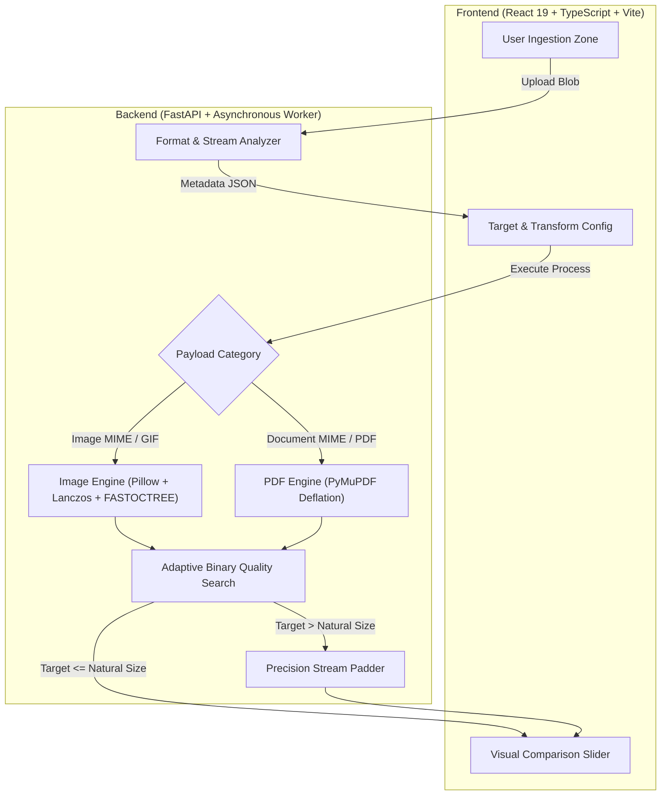
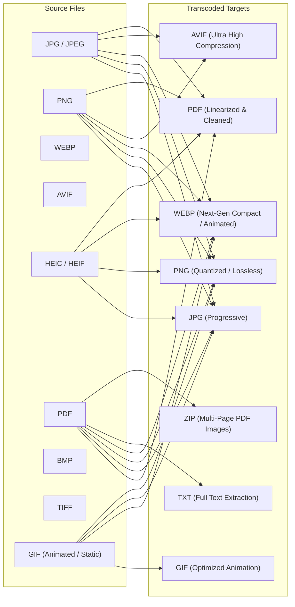

# SizeFix-Python - Advanced File Optimization & Conversion Engine

```text
  ____  _           _____ _        ____        _   _                 
 / ___|(_)_______  |  ___(_)_  __ |  _ \ _   _| |_| |__   ___  _ __  
 \___ \| |_  / _ \ | |_  | \ \/ / | |_) | | | | __| '_ \ / _ \| '_ \ 
  ___) | |/ /  __/ |  _| | |>  <  |  __/| |_| | |_| | | | (_) | | | |
 |____/|_/___\___| |_|   |_/_/\_\ |_|    \__, |\__|_| |_|\___/|_| |_|
                                         |___/                       
```

<p align="center">
  <strong>Local-First • Byte-Precision Target Matching • Universal Format Transcoding • 100% Private</strong>
</p>

<p align="center">
  <a href="https://fastapi.tiangolo.com"></a>
  <a href="https://react.dev"></a>
  <a href="https://www.typescriptlang.org"></a>
  <a href="https://vitejs.dev"></a>
  <a href="https://pymupdf.readthedocs.io"></a>
  <a href="https://python-pillow.org"></a>
</p>

---

## Executive Summary

**SizeFix-Python** is an ultra-fast, local-first file processing suite engineered for strict target size control and seamless format conversions. Built with a high-performance Python backend (`FastAPI`, `Pillow`, `PyMuPDF`, `pillow-heif`) and a tactile Neo-Brutalist React frontend, SizeFix-Python eliminates the guesswork of portal uploads, government forms, archival standards, and web distribution limits.

No telemetry. No third-party cloud uploads. Zero data leaves your machine.

---

## Key Highlights

- **Sub-Percent Target Precision**: Proprietary **Two-Phase Binary Search + Micro-Scale Tuning** delivers output within ±0.5% of exact user-specified targets (`B`, `KB`, `MB`, `GB`).
- **Bidirectional Target Control**: Supports lossless compression, smart deflation, as well as standards-compliant size expansion (up to `999 KB+`) via non-destructive stream padding.
- **Multi-Page PDF to Image Transcoding**: Convert multi-page PDFs to JPG/PNG/WEBP as packaged `.zip` archives containing all pages, continuous vertically-stitched images, or first-page cover thumbnails.
- **Full Animated GIF & WEBP Engine**: Compress and resize animated GIFs without losing animation frames, maintaining exact frame timings, loop counters, and alpha transparency with adaptive FASTOCTREE palette quantization.
- **Neo-Brutalist Aesthetic**: Strict `0px` border-radius geometry with a vibrant Raspberry palette (`#FFF5F8` → `#C92F5B`), dark mode support, and tactile 4px offset shadows.
- **Universal Cross-Platform Responsiveness**: Engineered for flawless touch and mouse workflows across Windows, macOS, Linux, iOS, and Android.
- **100% Local & Ephemeral**: Direct streaming architecture with automated zero-footprint memory management and instant disk cleanup.

---

## Interface Showcase

<div align="center">

### 1. Precision Ingestion & Format Zone


<br/>

### 2. Live Target Matching & Interactive Visual Comparison


</div>

---

## System Architecture & Data Flow



---

## Core Optimization Engines

### 1. Dual-Phase Image Micro-Tuner (`ImageProcessor`)
When targeting precise file sizes (e.g. `600.00 KB`), typical encoders produce step-quantized jumps due to discrete quality integer limits (`1-100`). SizeFix-Python solves this via a two-phase convergence loop:

1. **Phase 1 - Coarse Binary Search**: Binary searches the JPEG/WEBP quality continuum across an adaptive scale ladder ($0.2\times$ to $2.5\times$).
2. **Phase 2 - Micro-Resolution Dithering**: Fine-tunes image boundaries with fractional $\pm 0.5\%$ Lanczos scale factors to hit byte targets with $<0.2\%$ variance.
3. **Animated Frame Preservation**: Iterates all frames via `ImageSequence.Iterator`, maintaining per-frame durations, alpha transparency, and disposal metadata across GIF and WEBP formats.

### 2. Deep PDF Stream Deflator (`PDFProcessor`)
PDF documents undergo multi-layer inspection:
- **Structural Optimization**: Garbage collection pass (`level=4`), cross-reference table deduplication, unreferenced object pruning.
- **Embedded Raster Downsampling**: Extracts embedded images, converts color spaces (CMYK/RGBA $\rightarrow$ RGB), and recompresses streams with progressive DCT.
- **Selectable Text Preservation**: Retains all native vector paths, fonts, forms, and OCR layers intact.
- **Multi-Page Render Modes**: When transcoding PDFs to image formats (JPG, PNG, WEBP), exports all pages as a packaged `.zip` archive, stitches pages vertically, or exports the first-page thumbnail.

---

## Target Size Modes & Practical Use Cases

| Mode | Behavior | Ideal Use Cases |
| :--- | :--- | :--- |
| **`Maximum Size`** | Aims to keep the resulting file size at or below your target (**$\le$ target bytes**). If natural compression already satisfies the target, the highest visual quality under the ceiling is preserved without unnecessary downsampling. | **Strict Upload Ceilings**: Government application portals (UPSC, SSC, State PSCs, Passport Seva, Visa application forms) requiring files under strict caps (e.g. *"Photo must be under 50 KB"*, *"Certificate under 200 KB"*), email attachment caps (20–25 MB), and university portals. |
| **`Closest Size`** | Drives the optimization engine to match the exact target byte count using quality tuning, micro-scaling, or standards-compliant non-destructive stream padding for size enlargement. | **Minimum Size Requirements & Precision Matching**: Portals enforcing minimum size thresholds (e.g. *"File must be at least 50 KB"* or *"Between 100 KB and 100 KB"*). Safely expands a small 15 KB scan to 100 KB without damaging visual clarity or corrupting page structures. |
| **`Size Range`** | Targets a balanced tolerance bracket ($\pm 5\%$ to $10\%$ of target bytes) while prioritizing visual fidelity and processing speed. | **Web Asset Budgets & Flexible Uploads**: Preparing hero images, blog graphics, or catalog photos targeted for a reasonable web budget (e.g. ~150 KB) without harsh compression artifacts; messaging and team drive sharing. |

---

## Comprehensive Format Support Matrix



---

## Quickstart Guide

### Prerequisites
- **Python**: `3.10+` (tested with Python 3.11, 3.12, 3.13, 3.14)
- **Node.js**: `18.0+` & `npm`

### 1. Setup & Launch Backend

```bash
# Navigate to backend directory
cd backend

# Create virtual environment & activate
python3 -m venv .venv
source .venv/bin/activate  # On Windows: .venv\Scripts\activate

# Install high-performance dependencies
pip install -r requirements.txt

# Launch FastAPI development server
python -m uvicorn app.main:app --host 0.0.0.0 --port 8000 --reload
```
*Backend runs locally at: `http://localhost:8000` (Interactive API Docs: `http://localhost:8000/docs`)*

### 2. Setup & Launch Frontend

```bash
# In a new terminal, navigate to frontend
cd frontend

# Install packages
npm install

# Start Vite dev server
npm run dev -- --host 0.0.0.0 --port 5173
```
*Access web application at: `http://localhost:5173`*

---

## Deployment Guide

SizeFix-Python is engineered for seamless dual-tier deployment on **Vercel** (Frontend) and **Render** (Backend):

### 1. Deploy Frontend to Vercel
1. Import your GitHub repository into [Vercel](https://vercel.com).
2. Configure project settings:
   - **Framework Preset**: `Vite`
   - **Root Directory**: `frontend`
   - **Build Command**: `npm run build`
   - **Output Directory**: `dist`
3. Set environment variable:
   - `VITE_API_BASE`: URL of your Render backend (e.g. `https://sizefix-python-api.onrender.com`)
4. Click **Deploy**.

### 2. Deploy Backend to Render
The high-performance Python engine deploys directly via Render's Web Service:
1. Create a new **Web Service** from your repository.
2. Render automatically detects [`render.yaml`](./render.yaml) (`sizefix-python-api`), or configure manually:
   - **Root Directory**: `backend`
   - **Runtime**: `Python 3` or `Docker`
   - **Build Command**: `pip install -r requirements.txt`
   - **Start Command**: `uvicorn app.main:app --host 0.0.0.0 --port $PORT`
3. Optional: Set `FRONTEND_URL` environment variable to your Vercel deployment URL for strict CORS isolation.

---

## REST API Documentation

### 1. `POST /api/v1/analyze`
Inspects incoming binary streams without writing to disk.

```bash
curl -X POST "http://localhost:8000/api/v1/analyze" \
  -F "file=@document.pdf"
```

**Sample Response:**
```json
{
  "filename": "document.pdf",
  "extension": "pdf",
  "category": "document",
  "size_bytes": 129290,
  "size_human": "126.26 KB",
  "mime_type": "application/pdf",
  "pdf_pages": 2,
  "is_supported": true
}
```

### 2. `POST /api/v1/process`
Executes precision optimization or format transcoding.

```bash
curl -X POST "http://localhost:8000/api/v1/process" \
  -F "file=@animation.gif" \
  -F "target_size=500 KB" \
  -F "target_mode=maximum" \
  -F "output_format=gif" \
  -F "quality=85"
```

---

## Test Suite & Validation

SizeFix-Python comes equipped with a comprehensive unit and integration test suite covering image quantization, boundary conditions, corrupt streams, animated GIFs, and PDF parsing:

```bash
cd backend
.venv/bin/pytest -v
```

```text
============================== 35 passed in 0.71s ==============================
tests/test_analyzer.py::test_analyze_jpeg PASSED                         [ 3%]
tests/test_analyzer.py::test_analyze_png PASSED                          [ 6%]
tests/test_analyzer.py::test_analyze_pdf PASSED                          [ 9%]
tests/test_image_processor.py::test_jpeg_compression_and_quality PASSED  [46%]
tests/test_image_processor.py::test_animated_gif_compression_preserves_animation PASSED [57%]
tests/test_image_processor.py::test_animated_gif_resize_preserves_animation PASSED [60%]
tests/test_image_processor.py::test_animated_gif_to_webp_preserves_animation PASSED [63%]
tests/test_pdf_processor.py::test_pdf_structure_and_image_compression PASSED [74%]
tests/test_pdf_processor.py::test_pdf_to_jpg_separate_all_pages PASSED   [83%]
tests/test_pdf_processor.py::test_pdf_to_jpg_stitch PASSED               [86%]
tests/test_size_parser.py::test_parse_target_input_unified PASSED        [94%]
...
```

---

## Visual Identity & Neo-Brutalist Design Tokens

| Token | Hex Value | Application |
| :--- | :--- | :--- |
| `--bg-main` | `#FFF5F8` / `#1D0811` | Primary workspace canvas |
| `--bg-surface` | `#FFE9F0` / `#2C0E1C` | Elevated secondary surfaces |
| `--strong-raspberry` | `#C92F5B` / `#E94F7A` | Primary CTA, active badges, progress tracks |
| `--border-color` | `#35141F` / `#FFB6C1` | Sharp 2px architectural strokes |
| `--shadow-main` | `4px 4px 0px var(--border)` | Neo-Brutalist offset tactile drop shadow |
| `--radius` | `0px` | Strict perpendicular geometry |

---

## Security & Privacy Guarantee

- **Zero Remote Dependencies**: Works completely offline or local-network. No third-party analytics or external CDNs required.
- **EXIF Stripping**: Optional automated purge of GPS coordinates, device serial numbers, camera maker notes, and author metadata.
- **Resource Guardrails**: Strict streaming caps (200 MB per payload) and deterministic temporary file pruning prevent disk and memory exhaustion.
